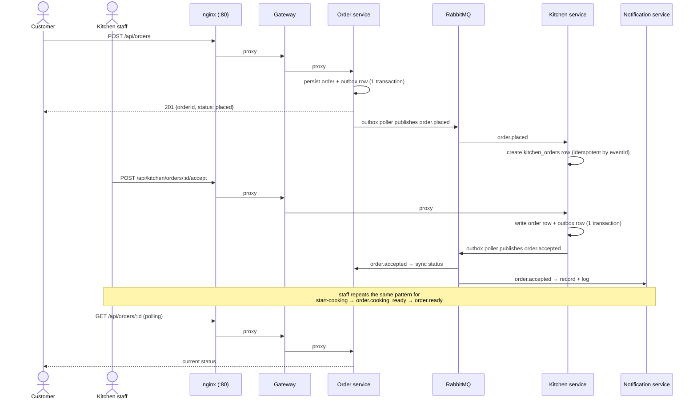

<div align="center">

# QuickBite

**An event-driven food-ordering platform where four microservices coordinate over RabbitMQ instead of calling each other directly.**

A systems-design project, not a CRUD tutorial — the point is the event flow, per-service data ownership, and failure handling, not the menu screen.

[](https://www.typescriptlang.org/)
[](https://bun.sh)
[](https://fastify.dev)
[](https://www.rabbitmq.com/)
[](https://www.postgresql.org)
[](https://redis.io)
[](https://react.dev)
[](https://nginx.org)
[](https://www.docker.com/)
[](https://github.com/devinder-dev/quickbite/actions/workflows/ci.yml)
[](LICENSE)

</div>

---

## What this is

Four Fastify services — **menu**, **order**, **kitchen**, **notification** — sit
behind a gateway and an nginx entry point, each owning its own PostgreSQL
database and never touching another service's tables. Placing an order is a
synchronous HTTP call; everything that happens *after* that (kitchen staff
accepting it, cooking, marking it ready, order syncing its own status,
notification logging every step) happens entirely through `order.placed` /
`order.accepted` / `order.cooking` / `order.ready` events on a RabbitMQ topic
exchange. Adding the notification service required zero changes to order or
kitchen — that's the actual argument for doing it this way.

## How it works



- **nginx is the only public entry point.** RabbitMQ, Postgres, Redis, the
  gateway, and the frontend container are all reachable only from other
  containers on the internal Docker network — never from the host.
- **No automatic timer anywhere.** Kitchen staff drive placed → accepted →
  cooking → ready by hand from the dashboard; each click is what publishes
  the next event.
- **Transactional outbox, not a direct publish.** Order and kitchen both
  write their event to an `outbox` table in the same DB transaction as the
  actual state change, then a separate poller drains and publishes it. A
  crash between commit and publish can't silently lose an event.

## Status

| Component | State |
|---|---|
| nginx entry point + gateway proxy (menu / order / kitchen) | ✅ |
| Menu, order, kitchen, notification services — each own Postgres DB | ✅ |
| Transactional outbox (order + kitchen) | ✅ |
| RabbitMQ topic exchange, automatic reconnection | ✅ |
| Redis-backed idempotency, per-consumer namespacing | ✅ |
| Retry with exponential backoff (1s/2s/4s) → dead-letter queue | ✅ |
| React frontend — cart, live order tracking, toast notifications | ✅ |
| Kitchen dashboard — accept / start cooking / mark ready | ✅ |
| Unit + integration (Testcontainers) + e2e tests, across every service and the frontend | ✅ |
| CI: typecheck + full test suite on every push/PR | ✅ |

Unit, integration, and end-to-end suites exist for all five backend
services and the frontend (`services/*/tests`, `frontend/tests`,
`tests/e2e`) — no infrastructure is mocked; integration and e2e tests spin
up real Postgres/RabbitMQ/Redis via Testcontainers.

## Quick start

```bash
git clone https://github.com/devinder-dev/quickbite.git
cd quickbite
docker compose up --build
```

Database schemas and seed data are created automatically on first boot — no
manual setup steps. Public entry point: **http://localhost** (nginx on port
80; nothing else is exposed to the host with this command).

```bash
# Place an order
curl -X POST http://localhost/api/orders \
  -H 'content-type: application/json' \
  -d '{"customerId":"33333333-3333-3333-3333-333333333333","items":[{"menuItemId":"44444444-4444-4444-4444-444444444444","name":"Gyros","quantity":2,"priceCents":1100}]}'

# Check its status (replace with the orderId from the response above)
curl http://localhost/api/orders/<orderId>

# Kitchen staff actions — a human drives each step, no timer:
curl -X POST http://localhost/api/kitchen/orders/<orderId>/accept
curl -X POST http://localhost/api/kitchen/orders/<orderId>/start-cooking
curl -X POST http://localhost/api/kitchen/orders/<orderId>/ready
```

Frontend: **http://localhost/** (customer app) and **http://localhost/kitchen**
(staff dashboard) — same nginx, same port, so there's no CORS config anywhere.

<details>
<summary><b>Full architecture reasoning</b> (click)</summary>

```
                              +-- /            --> frontend (React UI: customer app + kitchen dashboard)
client → nginx (:80) --------+
                              +-- /api/*, /health --> gateway → menu / order / kitchen   (synchronous reads + staff actions)
                                                          |
                                                          v
                                                    order.placed (RabbitMQ)
                                                          |
                                                          v
                                                       kitchen
                                          (a human accepts, starts cooking, marks ready —
                                           no automatic timer; each step publishes its own event)
                                                          |
                                             +------------+------------+
                                             v                         v
                                           order                  notification
                                   (syncs its own status)   (logs every order event)
```

- Synchronous HTTP exists only on the path client → nginx → gateway →
  service, for user-facing reads (menu, order status) **and** kitchen staff
  actions (accept / start cooking / mark ready). The order workflow itself
  (placed → accepted → cooking → ready → notified) happens entirely over
  RabbitMQ events.
- Each service owns its own Postgres database (`docker/init.sql` creates one
  database per service on first boot); none of them ever reads or writes
  another service's tables.
- The gateway (`services/gateway/src/index.ts`) is a small hand-rolled proxy
  built on Bun's native `fetch()` rather than `@fastify/http-proxy` — that
  plugin's underlying `undici` Pool isn't fully compatible with Bun's
  runtime.

</details>

<details>
<summary><b>Event catalog</b> (click)</summary>

All events are published on a single topic exchange (`quickbite.events`) and
schema-validated with Zod on both publish and consume
(`packages/shared/src/events.ts`):

| Event | Published by | Consumed by |
|---|---|---|
| `order.placed` | order (via outbox) | kitchen, notification |
| `order.accepted` | kitchen (via outbox) | order, notification |
| `order.cooking` | kitchen (via outbox) | order, notification |
| `order.ready` | kitchen (via outbox) | order, notification |

Every event carries an envelope (`eventId`, `occurredAt`) used for
idempotent consumption — each consumer dedupes redelivered events by
`eventId` in Redis, namespaced per consumer (`RedisIdempotency("kitchen")`,
`"order"`, `"notification"`) so two services consuming the same event never
interfere with each other.

</details>

<details>
<summary><b>Resilience features</b> (click)</summary>

- **Transactional outbox** (order + kitchen) — events are written to an
  outbox table in the same DB transaction as the state change, then
  published by a separate 1s poller. A crash between commit and publish
  can never silently drop an event.
- **Automatic RabbitMQ reconnection** — a dropped broker connection
  recovers on its own; consumers and outbox pollers resume without a
  service restart.
- **Redis-backed idempotency** — every consumer dedupes redelivered events
  by `eventId`, namespaced per consumer.
- **Retry with exponential backoff** — a failing handler gets 3 retries
  (1s / 2s / 4s) via a dead-letter-based delay queue before landing in the
  permanent dead-letter queue.
- **Ordered delivery where it matters** — order's consumer for
  `order.accepted` / `order.cooking` / `order.ready` uses `prefetch: 1` so
  the three state transitions for one order are always applied in the
  order they happened, never processed concurrently out of order.

</details>

<details>
<summary><b>Frontend</b> (click)</summary>

A React 19 UI lives at `http://localhost/` — menu → cart → place order → a
status screen that polls `GET /api/orders/:id` live as it moves placed →
accepted → cooking → ready, plus a localStorage-backed order history.
Order tracking is lifted to the app level (`OrderTrackingContext`) rather
than scoped to one page, so a persistent progress banner and toast
notifications follow you while browsing the menu or order history.

**Kitchen dashboard** (`/kitchen`) is the staff-facing side of the same app:
every order not yet ready, each with exactly one button for its current
stage. Clicking through is what actually publishes the next event — no
authentication, matching the rest of this no-auth course project.

```bash
docker compose up -d
bun run dev:frontend   # Vite dev server; proxies /api to http://localhost:80
```

</details>

<details>
<summary><b>Local development & tests</b> (click)</summary>

For direct access to Postgres/RabbitMQ/Redis (a DB GUI, or running one
service bare with `bun run dev:<service>` against dockerized infra):

```bash
docker compose -f docker-compose.yml -f docker-compose.dev.yml up
```

```bash
bun run test       # unit + integration (Testcontainers) + end-to-end
bun run typecheck
```

Runs automatically in CI on every push and pull request
(`.github/workflows/ci.yml`). No mocks for any infrastructure — integration
and e2e tests spin up real Postgres/RabbitMQ/Redis containers. The
frontend's tests are split the same way: pure logic (`frontend/tests/lib/`,
no DOM) and component-rendering tests (`frontend/tests/components/`, real
DOM via happy-dom + Testing Library).

</details>

---

<div align="center">

**Devinder Singh** · Fullstack Developer (YH) student at Chas Academy, Stockholm

</div>
